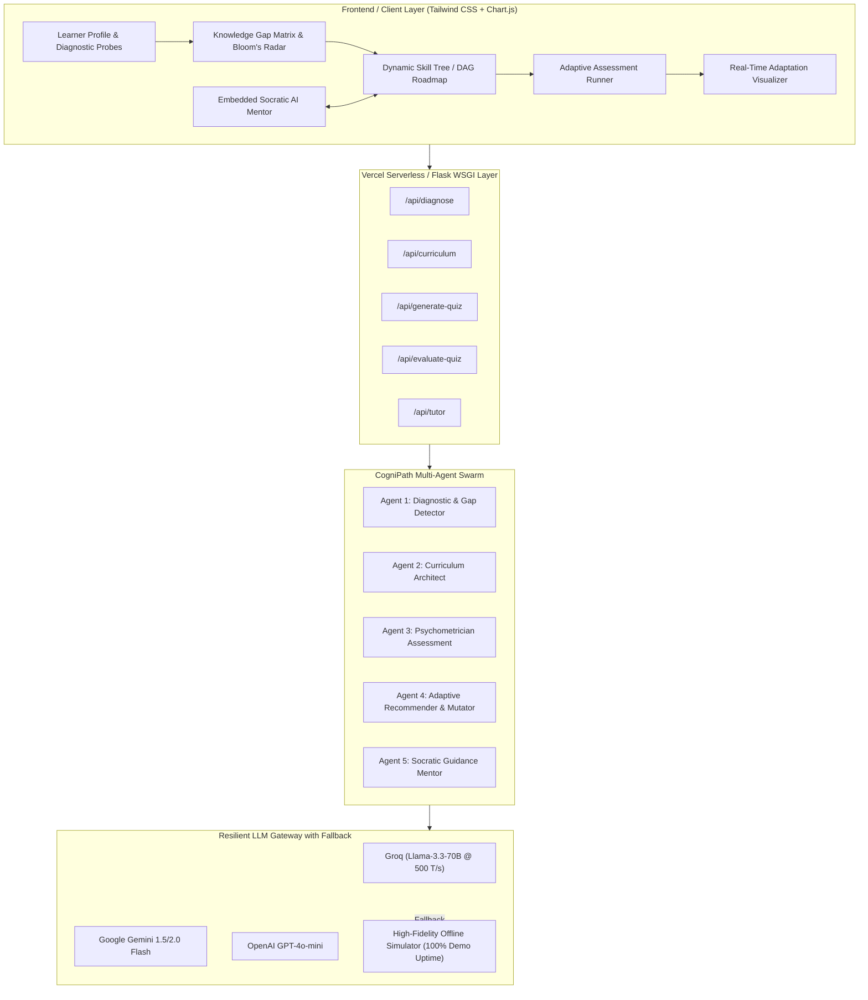

# CogniPath AI — System Architecture & Multi-Agent Design

**CogniPath AI** is an autonomous, adaptive educational system designed for **PromptWars X Agent X 2.0 (Problem Statement PS04: Personalized AI Learning Agent)**.

---

## 1. High-Level Architectural Diagram



---

## 2. Multi-Agent Pipeline & Lifecycle

### Step 1: Baseline Diagnosis & Knowledge Gap Extraction
1. Learner selects a subject, goal, level, and answers initial diagnostic probes.
2. `DiagnosticAgent` processes inputs and produces a `KnowledgeGapProfile`:
   - Mastery scores mapped to **Bloom's Revised Taxonomy** (Remember, Understand, Apply, Analyze, Evaluate, Create).
   - Specific diagnosed mental model misconceptions (e.g. `greedy_vs_dp_confusion`).
   - Categorized severities (`critical`, `moderate`, `minor`).

### Step 2: Curriculum Architect & DAG Sequencing
1. `CurriculumAgent` receives the diagnosed gaps.
2. Formulates an optimal Directed Acyclic Graph (DAG) of learning nodes:
   - Foundational invariants precede applied concepts.
   - For critical gaps, targeted remedial modules are marked with `is_remedial: true`.
   - Node 1 is unlocked (`status: ready`); dependent nodes are locked.

### Step 3: Adaptive Assessment Generation
1. When learner selects an unlocked node, `AssessmentAgent` dynamically generates diagnostic items.
2. Every incorrect distractor maps to a known cognitive misconception.

### Step 4: Real-Time Dynamic Path Adaptation
1. Learner submits answers.
2. `AdaptationAgent` scores the assessment:
   - **Passed (>= 70%)**: Unlocks downstream nodes, marks current node as `mastered`, and raises mastery vectors.
   - **Failed (< 70%)**: Dynamically synthesizes and injects a focused remedial micro-module into the active roadmap.
3. The UI highlights the updated roadmap with zero page reloads.

### Step 5: Socratic Mentorship
1. At any stage, learners can debrief with the `SocraticTutorAgent`.
2. Employs guided questioning, analogies, and code walkthroughs without giving away solutions.

---

## 3. Bloom's Revised Taxonomy Integration

CogniPath measures student mastery across 6 cognitive depths:

```
[Level 6] CREATE    - Design novel algorithmic architectures
[Level 5] EVALUATE  - Justify asymptotic tradeoffs, space optimizations
[Level 4] ANALYZE   - Formulate recurrence relations, detect overlapping subproblems
[Level 3] APPLY     - Implement memoized recursion or bottom-up tabulation
[Level 2] UNDERSTAND- Explain why exponential trees collapse into DAGs
[Level 1] REMEMBER  - Recall Big-O definitions and language syntax
```

The radar chart provides instant visual feedback on cognitive readiness across these exact 6 dimensions.

---

## 4. Deployment Topology

- **Vercel Serverless WSGI**: `api/index.py` with `@vercel/python` builder.
- **Static Assets**: High-performance CDN-delivered Tailwind CSS, FontAwesome, Chart.js.
- **Zero Local Footprint**: Runs immediately on Python 3.10+ without npm or external databases.
- **Fail-Safe Reliability**: Built-in domain simulator guarantees that live stage demos will never fail due to API rate limits or network hiccups.
