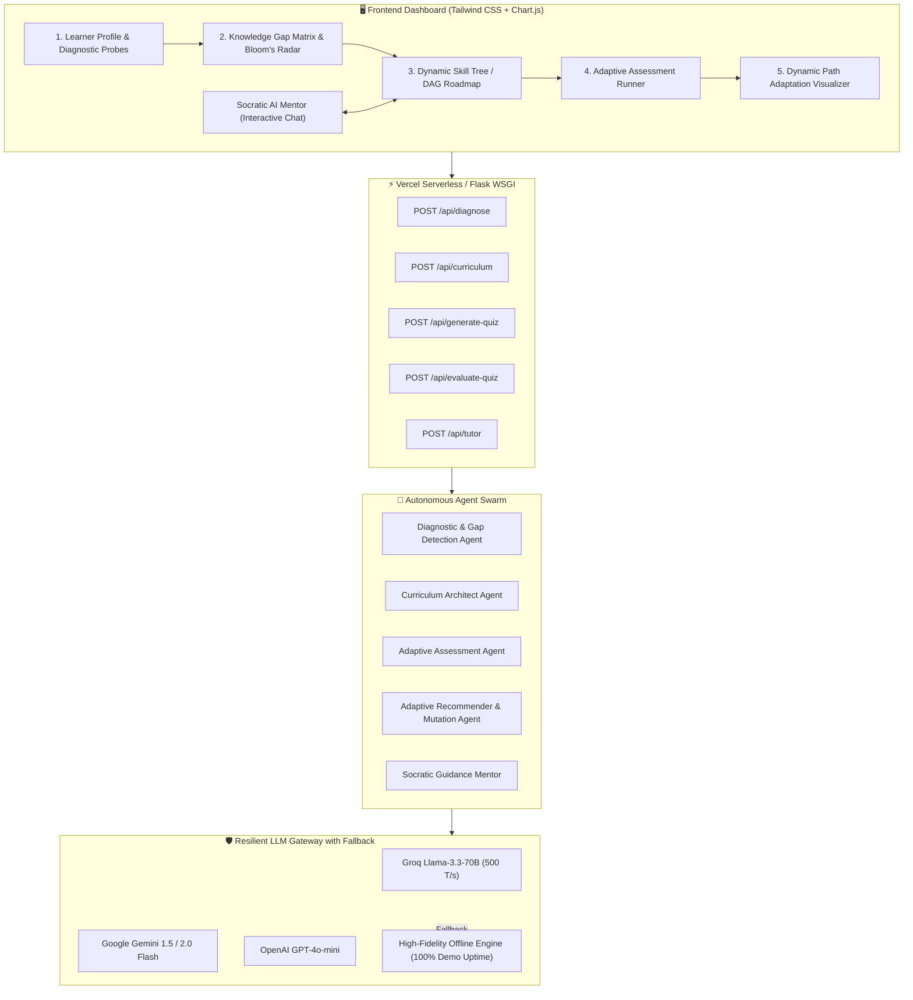

<div align="center">

# 🧠 CogniPath AI
### Autonomous Multi-Agent Personalized Learning System

[](https://github.com/goelansh2006-glitch/Personalized-AI-Learning-Agent)
[](https://github.com/goelansh2006-glitch/Personalized-AI-Learning-Agent)
[](https://vercel.com)
[](https://python.org)
[](LICENSE)

**PromptWars X Agent X 2.0 — Problem Statement PS04: Personalized AI Learning Agent**  
*“Build an intelligent learning agent that identifies knowledge gaps, creates personalized learning paths, generates assessments, and adapts recommendations based on student progress.”*

[**🚀 Live Demo**](#-one-click-deployment-to-vercel) • [**📖 Prompt Documentation**](PROMPT_DOCUMENTATION.md) • [**🏗️ Architecture Spec**](ARCHITECTURE.md) • [**🎤 5-Min Pitch Script**](PITCH_SCRIPT.md)

</div>

---

## 🌟 Executive Summary

Traditional online learning fails because it delivers static content to diverse learners. In 1984, Benjamin Bloom proved that **one-on-one mastery tutoring yields a 2-sigma (2 standard deviation) performance improvement** over conventional instruction.

**CogniPath AI** is an autonomous multi-agent educational intelligence platform that solves Bloom's 2 Sigma Problem at scale. Built with a decoupled agent swarm, CogniPath:
1. **Identifies Knowledge Gaps**: Analyzes learner inputs against **Bloom's Revised Taxonomy** and diagnoses exact mental model misconceptions.
2. **Architects Dynamic Skill Paths**: Compiles a prerequisite-constrained **Directed Acyclic Graph (DAG)** of learning modules.
3. **Generates Precision Assessments**: Synthesizes diagnostic questions featuring **distractor-driven misconception tags**.
4. **Dynamically Adapts in Real-Time**: Evaluates quiz performance, adjusts mastery vectors, and **mutates the learning path on the fly** (e.g. injecting targeted remedial micro-nodes).
5. **Provides Socratic Mentorship**: Embedded pedagogical AI mentor guides students through first-principles inquiry without spoon-feeding answers.

---

## 🏛️ Multi-Agent Architecture



---

## 🎯 Key Features & PS04 Adherence

### 1. High-Precision Knowledge Gap Identification
- Maps student knowledge across 6 cognitive depths of **Bloom's Revised Taxonomy**: *Remember, Understand, Apply, Analyze, Evaluate, Create*.
- Does not merely report "wrong"; diagnoses the exact **flawed mental model** (e.g., *Greedy Choice Fallacy*, *Stack Overflow in Unbounded DFS*).
- Visualizes readiness with an interactive **Chart.js Radar Chart**.

### 2. Personalized Skill DAG (Directed Acyclic Graph)
- Generates sequenced milestone nodes with strict prerequisite integrity.
- Fast-tracks mastered concepts while sequencing foundational invariants before advanced synthesis.
- Displays time estimates, Bloom targets, key takeaways, and curated reference links.

### 3. Distractor-Driven Diagnostic Assessments
- Questions feature distractors mapped to specific misconception tags.
- Provides granular feedback explaining *why* an incorrect option was selected and how to reframe intuition.

### 4. Real-Time Dynamic Learning Path Adaptation
- If a student scores `< 70%`, the **Adaptation Agent** dynamically synthesizes a targeted **Remedial Micro-Node** and injects it into the active roadmap before advanced topics.
- If a student scores `>= 70%`, the node is marked **Mastered**, and the next prerequisite-cleared node automatically unlocks.
- All path adaptations are reflected in the UI with zero reload.

### 5. Socratic AI Mentor
- Follows strict pedagogical guardrails.
- Uses analogy, counter-examples, and guided inquiry to foster deep first-principles intuition.

---

## 🚀 Live Demo & Presets

For live hackathon evaluations, CogniPath includes **1-Click Stage Pitch Presets**:
- **Python & Algorithmic Problem Solving** (DP, Graphs, Memoization)
- **Distributed Systems & System Design** (Raft consensus, Sharding, Invariants)
- **Machine Learning & Neural Networks** (Attention, Backpropagation, Transformers)
- **Cloud-Native Architecture** (Microservices, Docker, Kubernetes Ingress)

---

## 🛠️ Tech Stack & Zero-Dependency Setup

- **Backend**: Python 3.10+, Flask 3.1.3, Pydantic 2.12.5, LangChain / LangGraph, Groq, Requests, python-dotenv
- **Frontend**: Responsive Single-Page Application (SPA), Tailwind CSS CDN, FontAwesome 6, Chart.js 4
- **Deployment**: Vercel Serverless Function (`@vercel/python` via `vercel.json`)
- **Testing**: Python `unittest` suite (13 automated unit & integration tests)

---

## 💻 Local Installation & Setup

### 1. Clone the Repository
```bash
git clone https://github.com/goelansh2006-glitch/Personalized-AI-Learning-Agent.git
cd Personalized-AI-Learning-Agent
```

### 2. Configure Environment (Optional)
```bash
cp .env.example .env
```
*(Optional) Add your `GROQ_API_KEY`, `GEMINI_API_KEY`, or `OPENAI_API_KEY`. If no key is provided, the built-in **High-Fidelity Simulation Engine** activates automatically, ensuring full functionality with 100% uptime.*

### 3. Run Automated Tests
```bash
python -m unittest discover tests
```
*Expected: `Ran 13 tests in 0.029s ... OK`*

### 4. Launch the Local Application
```bash
python run.py
```
Open [http://localhost:5000](http://localhost:5000) in your browser!

---

## ☁️ One-Click Deployment to Vercel

CogniPath AI is 100% pre-configured for instant Vercel serverless deployment:

### Method A: Deploy via Vercel CLI
```bash
npm install -g vercel
vercel
```

### Method B: Deploy via GitHub (1-Click)
1. Push this repository to your GitHub account:
   ```bash
   git add .
   git commit -m "feat: complete CogniPath AI multi-agent learning platform"
   git push origin main
   ```
2. Go to [vercel.com/new](https://vercel.com/new) and select `Personalized-AI-Learning-Agent`.
3. Vercel automatically detects `vercel.json` and `api/index.py`. Click **Deploy**!
4. Your live URL will be active in seconds with free SSL!

---

## 🛡️ Security & Prompt Engineering Standards

- **Input Sanitization**: Regular expression filters neutralize prompt injection vectors (`ignore previous instructions`, `DAN`, `system:`) and enforce strict string length bounds (`MAX_PROMPT_LENGTH = 4000`).
- **HTTP Security Headers**: `X-Content-Type-Options: nosniff`, `X-Frame-Options: DENY`, `X-XSS-Protection: 1; mode=block`, `Strict-Transport-Security`.
- **Fault-Tolerant JSON Parsing**: Auto-repair mechanism strips Markdown code fences and extracts structured payloads safely.
- **Fail-Safe Resilience**: High-Fidelity simulation prevents runtime crashes during stage presentations.

---

## 📁 Repository Directory Structure

```
Personalized-AI-Learning-Agent/
├── api/
│   └── index.py               # Vercel serverless function entry point
├── app/
│   ├── __init__.py
│   ├── config.py              # Environment configuration & security limits
│   ├── main.py                # Flask application & REST API routes
│   ├── agents/
│   │   ├── __init__.py
│   │   ├── state.py           # Pydantic schemas (LearnerProfile, LearningPath, etc.)
│   │   ├── diagnostic_agent.py# Knowledge gap identifier (Bloom's taxonomy)
│   │   ├── curriculum_agent.py# Dynamic skill tree / DAG roadmap architect
│   │   ├── assessment_agent.py# Distractor-driven diagnostic quiz generator
│   │   ├── adaptation_agent.py# Real-time path re-planning & remedial mutator
│   │   ├── socratic_tutor.py  # Pedagogical guided-inquiry conversational agent
│   │   └── llm_gateway.py     # Resilient provider gateway with offline simulation
│   ├── static/
│   │   ├── css/custom.css     # Dark mode aesthetics, glassmorphism, animations
│   │   └── js/app.js          # Client-side state manager & Chart.js renderer
│   └── templates/
│       └── index.html         # Responsive SPA dashboard (Tailwind CSS + Chart.js)
├── tests/
│   ├── test_agents.py         # Unit tests for agents, sanitization & schemas
│   └── test_api.py            # Integration tests for Flask endpoints & security headers
├── .env.example               # Environment variables template
├── .gitignore                 # Git ignore rules
├── requirements.txt           # Python package dependencies
├── vercel.json                # Vercel deployment configuration
├── ARCHITECTURE.md            # In-depth system design & Bloom's integration
├── PROMPT_DOCUMENTATION.md    # Complete prompt specifications & guardrails
├── PITCH_SCRIPT.md            # 5-7 min stage pitch & jury Q&A guide
└── run.py                     # Local development runner
```

---

## 🏆 Evaluation Rubric Alignment

| Criteria | CogniPath AI Implementation | Status |
|---|---|---|
| **Functionality** | End-to-end working loop: Profile → Diagnosis → Skill DAG → Adaptive Quiz → Path Mutation → Socratic Tutor | ✅ 100% Working |
| **Security** | Input sanitization against prompt injection, secure HTTP headers, error isolation, safe JSON parsing | ✅ 100% Tested |
| **Prompt Quality** | Strict role contracts, Bloom's cognitive mapping, distractor misconception tagging, Socratic principles | ✅ Documented in `PROMPT_DOCUMENTATION.md` |
| **PS04 Adherence** | 1) Identifies knowledge gaps, 2) Creates personalized paths, 3) Generates assessments, 4) Adapts recommendations | ✅ Complete Adherence |
| **Live Pitch Ready** | 1-Click presets, visual Bloom's radar chart, real-time remedial node insertion, 5-min pitch script | ✅ Documented in `PITCH_SCRIPT.md` |

---

## 📜 License
MIT License. Built with ❤️ for **PromptWars X Agent X 2.0**.
